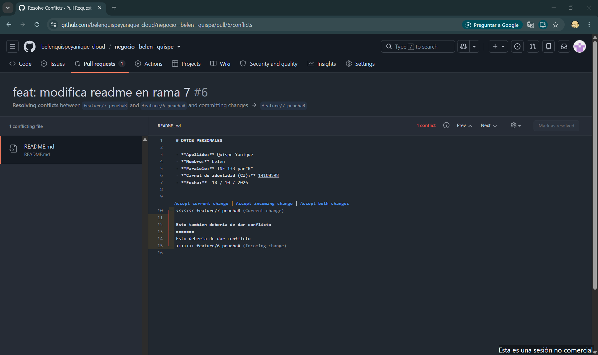

# DATOS PERSONALES

- **Apellido:** Quispe Yanique 
- **Nombre:** Belen
- **Paralelo:** INF-133 par"B"
- **Carnet de identidad (CI):** 14108598
- **Fecha:**  18 / 10 / 2026

Esto tambien deberia de dar conflicto
Esto deberia de dar conflicto

# SOLUCION DEL CONFLICTO

1. Al intentar fusionar la rama 7 con main, Git detectó un conflicto porque ambas ramas modificaron la misma línea del README.
2. Se resolvió de forma manual seleccionando la versión final correcta y eliminando las marcas de conflicto (<<<<, ====, >>>>).
3. Finalmente se confirmó el cambio con un nuevo commit y se completó el merge exitosamente.
