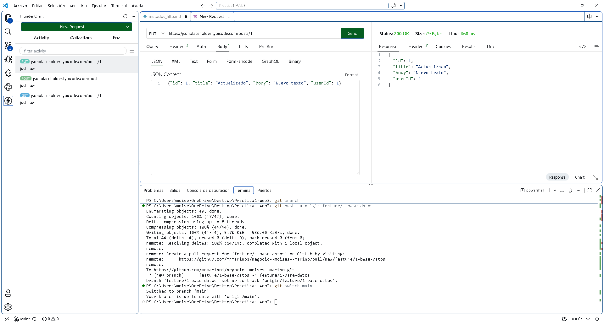
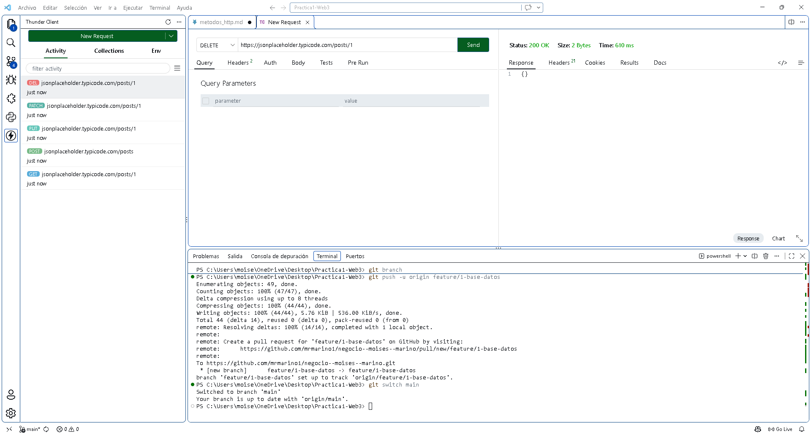

# Métodos HTTP

## 1. GET

*Para qué sirve:* Consulta datos.
* *URL:* https://jsonplaceholder.typicode.com/posts/1
* *Body:* Ninguno
* *Respuesta:* 200 OK
* *Captura:*
  

---

## 2. POST

*Para qué sirve:* Crea un recurso nuevo.
* *URL:* https://jsonplaceholder.typicode.com/posts
* *Body:* {"title": "Nuevo Post", "body": "Contenido", "userId": 1}
* *Respuesta:* 201 Created
* *Captura:*
  

---

## 3. PUT

*Para qué sirve:* Reemplaza un recurso completo.
* *URL:* https://jsonplaceholder.typicode.com/posts/1
* *Body:* {"id": 1, "title": "Actualizado", "body": "Texto", "userId": 1}
* *Respuesta:* 200 OK
* *Captura:*
  

---

## 4. PATCH

*Para qué sirve:* Modifica solo algunos datos (parcial).
* *URL:* https://jsonplaceholder.typicode.com/posts/1
* *Body:* {"title": "Nuevo título"}
* *Respuesta:* 200 OK
* *Captura:*
  

---

## 5. DELETE

*Para qué sirve:* Elimina un recurso.
* *URL:* https://jsonplaceholder.typicode.com/posts/1
* *Body:* Ninguno
* *Respuesta:* 200 OK
* *Captura:*
  

---

## Diferencia entre PUT y PATCH

* *PUT:* Funciona como un reemplazo total. Tienes que enviar el objeto entero con todos sus campos. Si olvidas mandar algún dato, este se borrará o quedará vacío en el servidor.
* *PATCH:* Funciona como una actualización quirúrgica o parcial. Solo envías los campos específicos que deseas cambiar (por ejemplo, solo el título), y el resto del registro se mantiene intacto.